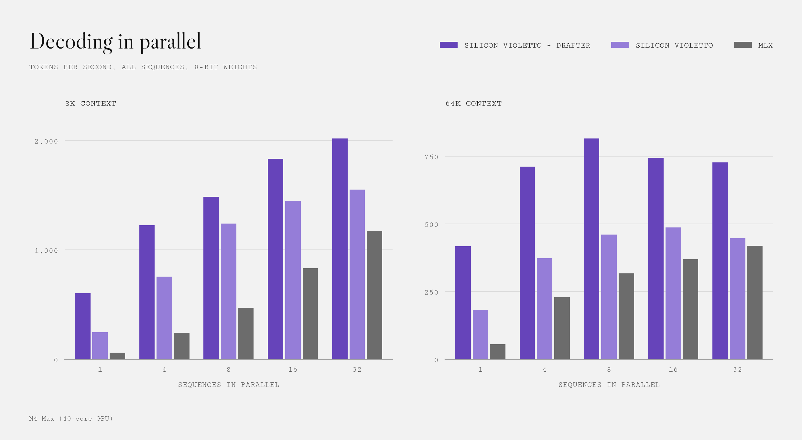
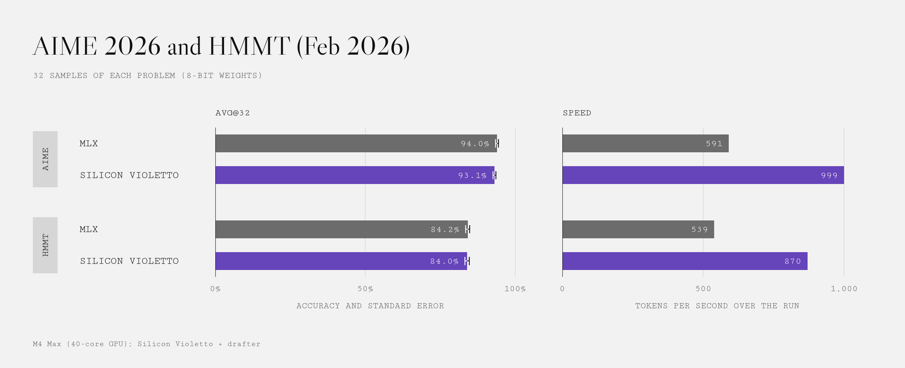

# Silicon Violetto

A fast Apple Silicon inference engine for [Limite 1B Violetto](https://huggingface.co/paradigma-inc/limite-1b-violetto)

- Supports both bf16 and 8bit quant
- Provides a drafter for maximum performance (roughly 2-2.5x single stream and 1.2-1.7x at 32 streams)
- Optimized for high performance on both single stream and batched generation
- Provides a OpenAI-compatible server

<picture>
  <source media="(prefers-color-scheme: dark)" srcset="docs/img/parallel-dark.png">
  
</picture>


On full runs of AIME 2026 and HMMT February 2026, it scores on par with MLX (within noise), and finishes in 60% of the time.

<picture>
  <source media="(prefers-color-scheme: dark)" srcset="docs/img/evals-dark.png">
  
</picture>

See other plots and exact numbers in [docs/performance.md](docs/performance.md).

## Getting started

Requirements: MacOS 14 or later, Rust, and uv.

```bash
cargo build --release

# Download and convert the model
uv run hf download paradigma-inc/limite-1b-violetto --local-dir models/limite-1b-violetto
uv run tools/convert.py --int8

# Download the drafter
uv run hf download Belluxx/limite-1b-violetto-drafter drafter.vlt --local-dir data/spec

# Start the server
./target/release/violetto serve --weights models/limite-int8.vlt --drafter data/spec/drafter.vlt --max-seqs 1
```

The server listens on `http://127.0.0.1:8000/v1`. **Important**: remember to raise `--max-seqs` (which is the defaulted to `1`) depending on your workload.

If you want to test it quickly, use `chat.py`:

```bash
uv run tools/chat.py
```

## Drafter

For more infos on the drafter and steps to train your own check [docs/drafter.md](docs/drafter.md).