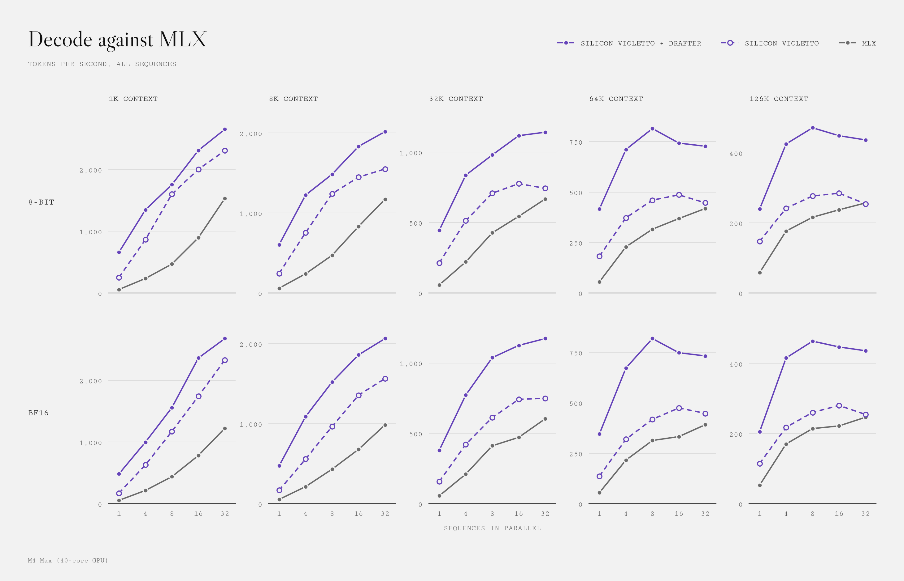
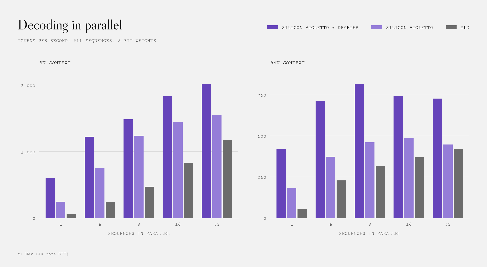
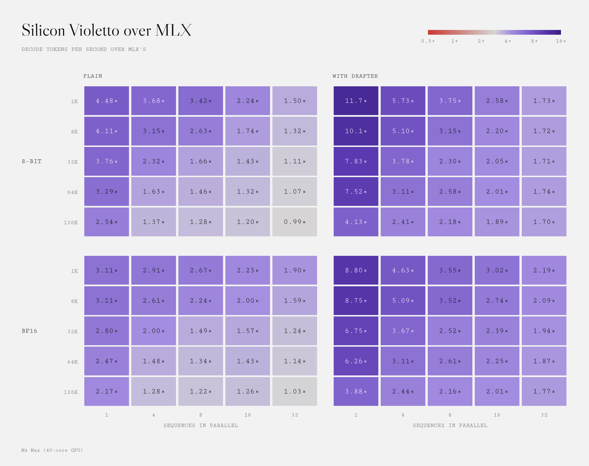
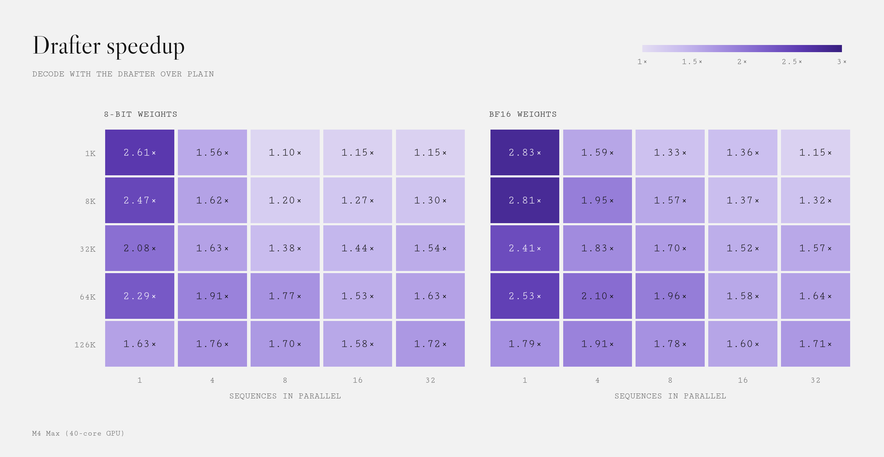
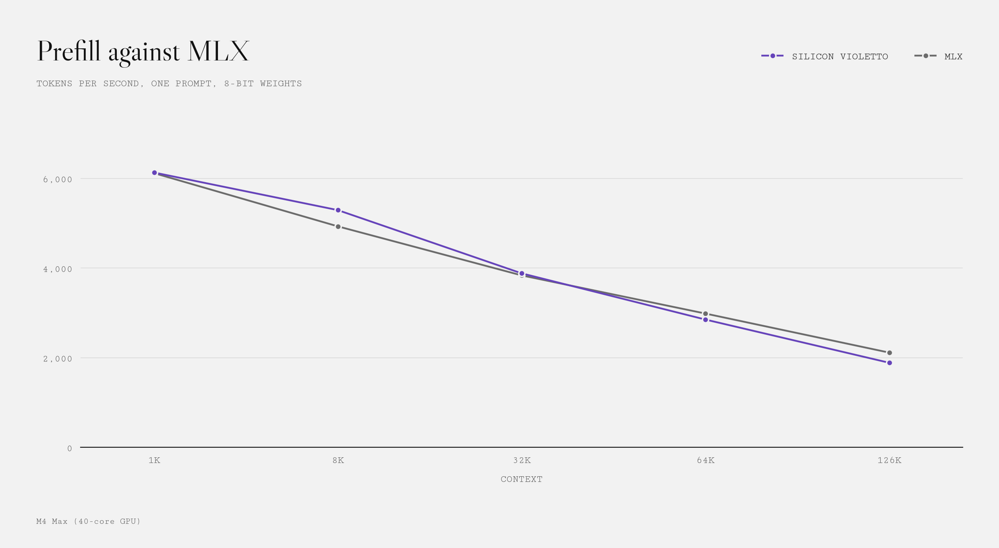
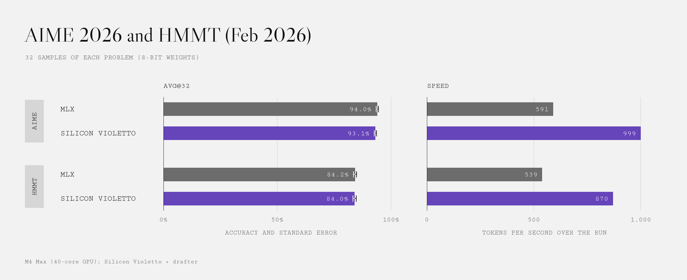
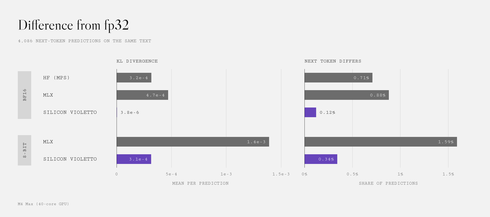

# Performance

Measured on an Apple M4 Max (40-core GPU, 64 GB), sampling at T = 0.6 and top-p 0.95.

- **MLX:** mlx-lm 0.32.2 on the [pierjoe/limite-1b-violetto-mlx-8bit](https://huggingface.co/pierjoe/limite-1b-violetto-mlx-8bit) and [-bf16](https://huggingface.co/pierjoe/limite-1b-violetto-mlx-bf16) ports, after warm-up.
- **HF:** transformers 5.6.2 on MPS, in bf16, after warm-up.

## Decode

<picture>
  <source media="(prefers-color-scheme: dark)" srcset="img/decode-dark.png">
  
</picture>

Tokens per second across all sequences, by sequences in parallel.

**8-bit weights:** with the drafter / plain / MLX

| Context | 1 | 4 | 8 | 16 | 32 |
|---|---:|---:|---:|---:|---:|
| 1k | 660 / 252 / 56 | 1347 / 864 / 235 | 1756 / 1602 / 469 | 2310 / 2004 / 896 | 2652 / 2306 / 1532 |
| 8k | 604 / 245 / 60 | 1224 / 755 / 240 | 1484 / 1240 / 471 | 1833 / 1448 / 831 | 2017 / 1550 / 1172 |
| 32k | 445 / 214 / 57 | 837 / 513 / 221 | 981 / 708 / 427 | 1118 / 777 / 544 | 1142 / 743 / 668 |
| 64k | 417 / 182 / 55 | 711 / 373 / 229 | 815 / 460 / 316 | 743 / 486 / 369 | 727 / 447 / 419 |
| 126k | 240 / 147 / 58 | 426 / 242 / 177 | 472 / 277 / 216 | 449 / 285 / 238 | 437 / 254 / 257 |

**bf16 weights:** with the drafter / plain / MLX / HF

| Context | 1 | 4 | 8 | 16 | 32 |
|---|---:|---:|---:|---:|---:|
| 1k | 484 / 171 / 55 / 43 | 998 / 628 / 216 / 88 | 1558 / 1172 / 439 / 103 | 2362 / 1741 / 782 / 134 | 2676 / 2330 / 1224 / 146 |
| 8k | 474 / 168 / 54 / 33 | 1090 / 559 / 214 / 46 | 1521 / 966 / 432 / 48 | 1861 / 1358 / 680 / 56 | 2065 / 1565 / 986 / 59 |
| 32k | 380 / 158 / 56 / 15 | 772 / 422 / 210 / 18 | 1038 / 612 / 412 / 18 | 1125 / 741 / 472 / 19 | 1174 / 750 / 604 / 18 |
| 64k | 347 / 137 / 55 / 9 | 673 / 320 / 216 / OOM | 819 / 419 / 314 / 10 | 748 / 475 / 333 / 9 | 733 / 448 / 392 / OOM |
| 126k | 205 / 115 / 53 / 5 | 416 / 218 / 171 / 5 | 464 / 261 / 215 / 5 | 448 / 281 / 222 / OOM | 437 / 255 / 247 / OOM |

<picture>
  <source media="(prefers-color-scheme: dark)" srcset="img/parallel-dark.png">
  
</picture>

### Over MLX

<picture>
  <source media="(prefers-color-scheme: dark)" srcset="img/over-mlx-dark.png">
  
</picture>

### What the drafter adds

<picture>
  <source media="(prefers-color-scheme: dark)" srcset="img/drafter-speedup-dark.png">
  
</picture>

## Prefill

One prompt, tokens per second and seconds for the whole prompt. The drafter doesn't change prefill.

<picture>
  <source media="(prefers-color-scheme: dark)" srcset="img/prefill-dark.png">
  
</picture>

| Context | Silicon Violetto 8-bit | MLX 8-bit | Silicon Violetto bf16 | MLX bf16 | HF bf16 |
|---|---:|---:|---:|---:|---:|
| 1k | 6129 (0.2 s) | 6115 (0.2 s) | 6254 (0.2 s) | 6367 (0.2 s) | 4182 (0.2 s) |
| 8k | 5290 (1.5 s) | 4928 (1.7 s) | 5391 (1.5 s) | 5142 (1.6 s) | 2220 (3.7 s) |
| 32k | 3880 (8.4 s) | 3834 (8.5 s) | 3957 (8.3 s) | 3969 (8.3 s) | 1717 (19.1 s) |
| 64k | 2849 (23.0 s) | 2983 (22.0 s) | 2880 (22.8 s) | 3060 (21.4 s) | OOM |
| 126k | 1885 (66.8 s) | 2112 (59.7 s) | 1898 (66.4 s) | 2150 (58.6 s) | OOM |

## Evals

AIME 2026 and HMMT February 2026. Both engines run 8-bit weights, Silicon Violetto runs with its drafter.

<picture>
  <source media="(prefers-color-scheme: dark)" srcset="img/evals-dark.png">
  
</picture>

| | Engine | avg@32 | Hit the token cap | Median tokens | Tokens | Hours | tok/s |
|---|---|---:|---:|---:|---:|---:|---:|
| AIME 2026 | Silicon Violetto | 93.12% ± 0.53% | 12 | 23,754 | 28.5M | 7.9 | 999 |
| | MLX | 93.96% ± 0.48% | 15 | 23,708 | 28.7M | 13.5 | 591 |
| HMMT Feb 2026 | Silicon Violetto | 84.00% ± 0.74% | 29 | 36,101 | 46.4M | 14.8 | 870 |
| | MLX | 84.19% ± 0.72% | 31 | 36,104 | 47.6M | 24.5 | 539 |

## Parity

Distance from the model computed in fp32, over 4,086 next-token predictions on the same text.

<picture>
  <source media="(prefers-color-scheme: dark)" srcset="img/parity-dark.png">
  
</picture>

| Weights | Engine | Mean KL divergence | Next token differs |
|---|---|---:|---:|
| bf16 | Silicon Violetto | 3.8e-6 | 0.12% |
| | MLX | 4.7e-4 | 0.88% |
| | HF | 3.2e-4 | 0.71% |
| 8-bit | Silicon Violetto | 3.1e-4 | 0.34% |
| | MLX | 1.4e-3 | 1.59% |
